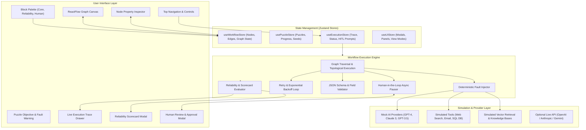

# 🧩 AI Workflow Puzzle Builder & Resilience Lab

A browser-accessible, interactive visual puzzle and learning lab where users master resilient AI application design. Assemble multi-step AI workflows, run sample inputs, trigger controlled failure scenarios, and repair systems using **Validation**, **Exponential Retries**, **Cascading Fallbacks**, and **Human-in-the-Loop Governance**.

---

## 🎥 Demo Video

- **Public URL**: `https://www.loom.com/share/7a517f32c2404c2dbe44ddb58d37211c`

---

## 🌟 Key Highlights & Features

- **🎮 Visual Drag & Drop Canvas**: Interactive flowchart builder powered by ReactFlow with custom node renderers, animated flow edges, minimap, and node inspectors.
- **🧩 8 Pre-Seeded Workflow Puzzles**: Beginner, Intermediate, and Advanced puzzles covering the most critical reliability failure modes in AI engineering.
- **💥 Deterministic Failure Simulator**: Repeatable fault injection (model timeouts, API 504s, malformed JSON, schema drift, low confidence, worker crashes).
- **🛡️ Resilience & Recovery Arsenal**:
  - **Schema & Rule Validators**: JSON Schema and custom code validators to reject hallucinations.
  - **Exponential Backoff Retries**: Configurable attempts, delays, and backoff multipliers.
  - **Cascading Fallbacks**: Seamless failover to secondary LLMs (e.g. Claude 3), cached snapshots, or safe defaults.
  - **Human-in-the-Loop (HITL)**: Interactive approval modal for inspecting, editing, or rejecting high-risk actions.
  - **Safe Stop & Checkpointing**: Graceful shutdown and state preservation.
- **📜 Live Execution Trace**: Real-time step-by-step stream inspector with inputs, outputs, elapsed durations, and retry counts.
- **📊 Reliability Scorecard & Feedback**: Calculates reliability scores (0–100%), verifies completion criteria, audits failure mitigation, and highlights concrete strengths and vulnerabilities.
- **🆓 100% Free Mock AI Engine**: Complete offline operation with zero API costs, plus optional support for live OpenAI, Anthropic, or Gemini API keys.

---

## 🏗️ System Architecture



---

## 🚀 Quick Start (Local Setup)

### Prerequisites
- Node.js (v18 or higher recommended)
- npm (v9 or higher)

### Installation & Run

```bash
# 1. Navigate to the project directory
cd ai-workflow-puzzle

# 2. Install dependencies
npm install

# 3. Start development server
npm run dev
```

Open your browser at `http://localhost:5173` to explore the application!

### Production Build & Verification

```bash
# Type check and build bundle
npm run build

# Run linter
npm run lint

# Preview production build
npm run preview
```

---

## 🎮 The 8 Pre-Seeded Puzzles

| # | Puzzle Title | Difficulty | Core Concept | Failure Scenario | Solution Pattern |
|---|--------------|------------|--------------|------------------|------------------|
| **1** | **Fix the Meeting Summarizer** | Beginner | Schema Validation & Output Repair | AI outputs JSON with missing/null `owner` keys | `Input` ➔ `AI Model` ➔ `Validator` ➔ `Fallback (Safe Default)` ➔ `Output` |
| **2** | **Ground the Knowledge Assistant** | Beginner | RAG Grounding & Refusal | Retrieval query returns empty evidence (score < 0.5) | `Input` ➔ `Retrieval` ➔ `Confidence Check` ➔ `Safe Stop / Refusal` ➔ `Output` |
| **3** | **Repair the Ticket Router** | Intermediate | Classification & Human Escalation | Multi-intent customer ticket has low confidence (0.48) | `Input` ➔ `AI Model` ➔ `Confidence Check` ➔ `Human Review` ➔ `Tool` ➔ `Output` |
| **4** | **Survive the Research Timeout** | Intermediate | Timeout Recovery & Cached Failover | Web research tool hits 504 Gateway Timeout | `Input` ➔ `Retry (3 attempts)` ➔ `Tool` ➔ `Fallback (Cached DB)` ➔ `Output` |
| **5** | **Approve Before Sending** | Intermediate | Human-in-the-Loop & High-Risk Gate | Unsupervised AI drafts excessive $500 monetary credit | `Input` ➔ `AI Model` ➔ `Approval Gate (HITL Modal)` ➔ `Email Tool` ➔ `Output` |
| **6** | **Validate the Data Extractor** | Advanced | Strict JSON Schema & Self-Healing Math | OCR model hallucinates total sum mismatch and drops currency | `Input` ➔ `AI Model` ➔ `Validator` ➔ `Transform (Math Repair)` ➔ `Output` |
| **7** | **Activate the Fallback** | Advanced | Multi-Model Redundancy & Cascade Failover | Primary GPT-4 hits 503 Outage / 429 Rate Limits | `Input` ➔ `Retry (2x)` ➔ `AI Model (GPT-4)` ➔ `Fallback (Claude 3)` ➔ `Output` |
| **8** | **Resume the Interrupted Mission** | Advanced | Checkpointing & State Resumption | Process crashes midway during synthesis step | `Input` ➔ `Ingest` ➔ `Extract` ➔ `Error Handler (Resume Checkpoint)` ➔ `Output` |

---

## 🧰 Available Workflow Blocks

### Core Execution Blocks
- **📥 Input**: Initial workflow payload / user prompt.
- **🤖 AI Model**: Configurable LLM prompt template (`{{input}}`), temperature, output format (Text/JSON/Structured), and system instructions.
- **🔧 Tool / API**: Simulated external tools (`web-search`, `calculator`, `weather-api`, `email-sender`, `database-query`).
- **🔍 Retrieval**: Simulated RAG vector search across knowledge bases (`company-docs`, `product-manuals`, `faq`, `codebase`).
- **🔀 Condition**: Dynamic branching with true/false handles based on JavaScript expressions.
- **🔄 Transform**: In-flight data transformation and schema adaptation.
- **📤 Output**: Final structured delivery payload.

### Reliability & Resilience Blocks
- **✅ Validator**: Strict JSON Schema, required fields, and custom JS validation with configurable failure actions (`retry`, `fallback`, `human-review`, `safe-stop`).
- **🔁 Retry**: Configurable maximum attempts, delays, and exponential backoff multiplier.
- **🛡️ Fallback**: Cascade failover to alternative models, static values, or safe defaults.
- **⏱️ Timeout**: Enforces upper latency bounds on asynchronous steps.
- **🛠️ Error Handler**: Catches exceptions and maps to recovery workflows.
- **🛑 Safe Stop**: Orderly controlled termination with structured explanation.

### Human Governance Blocks
- **👤 Human Review**: Pauses workflow execution for interactive manual inspection, editing, and decision-making.
- **🚪 Approval Gate**: Conditional sign-off gate for high-risk operations (e.g. monetary refunds, external emails).
- **📊 Confidence Check**: Enforces minimum confidence threshold on probabilistic outputs.

---

## 🔬 How Failure Simulation & Recovery Work

1. **Triggering Faults**: Toggle the **"Failure Simulation: ON/OFF"** button in the top navbar. When ON, the engine injects deterministic, repeatable faults into specific steps (e.g. timeout, missing keys, low confidence).
2. **Observing Failure**: Run the workflow. The visual canvas highlights the failing step in red with error messages, while the execution trace details the exact exception.
3. **Repairing the Workflow**: Drag blocks from the **Reliability** or **Human Control** categories to shield the fragile step.
4. **Validating Resilience**: Re-run the workflow. When the failure is mitigated, the node displays a purple `Recovered` or amber `Reviewing` badge, and the Reliability Scorecard awards 100% score with confetti!

---

## ⚙️ Configuration & Local Demo Mode

### 100% Free Local Mode (Default)
By default, the application runs entirely locally using realistic mock AI providers (`mock-gpt-4`, `mock-claude`, `mock-gpt-3.5`), simulated tool endpoints, and embedded vector knowledge bases. No internet connection or paid API keys are required.

### Optional Live AI Providers
To test workflows with real OpenAI, Anthropic, or Google Gemini models:
1. Click the **"Mock AI (Free)"** badge in the navbar.
2. Select your provider and enter your API key.
3. Keys are stored solely in your browser's `localStorage` and never transmitted to third parties.

---

## 📂 Project Structure

```
ai-workflow-puzzle/
├── index.html                   # Entry HTML with title & meta tags
├── package.json                 # Dependencies & scripts
├── postcss.config.js            # PostCSS configuration
├── tailwind.config.js           # Tailwind styling configuration
├── tsconfig.json                # TypeScript root configuration
├── tsconfig.app.json            # TypeScript frontend configuration
├── vite.config.ts               # Vite bundler configuration
├── src/
│   ├── main.tsx                 # Application mounting
│   ├── App.tsx                  # Top-level application component
│   ├── index.css                # Tailwind CSS and custom status classes
│   ├── vite-env.d.ts            # Vite client type references
│   ├── types/
│   │   ├── index.ts             # Core domain models (Puzzle, Step, Trace, Feedback)
│   │   └── blocks.ts            # 16 Block definitions and config schemas
│   ├── stores/
│   │   └── index.ts             # Zustand stores (Workflow, Puzzle, Execution, UI)
│   ├── puzzles/
│   │   ├── index.ts             # Puzzle registry and initial seed data
│   │   ├── puzzle1.ts           # Fix the Meeting Summarizer
│   │   ├── puzzle2.ts           # Ground the Knowledge Assistant
│   │   ├── puzzle3.ts           # Repair the Ticket Router
│   │   ├── puzzle4.ts           # Survive the Research Timeout
│   │   ├── puzzle5.ts           # Approve Before Sending
│   │   ├── puzzle6.ts           # Validate the Data Extractor
│   │   ├── puzzle7.ts           # Activate the Fallback
│   │   └── puzzle8.ts           # Resume the Interrupted Mission
│   ├── engine/
│   │   ├── workflowEngine.ts    # Graph DAG executor & async event loop
│   │   ├── validatorEngine.ts   # JSON Schema & custom rule validator
│   │   ├── toolSimulator.ts     # External tool call simulator
│   │   ├── retrievalSimulator.ts # Vector knowledge base search simulator
│   │   ├── mockProviders.ts     # Mock AI models & failure injector
│   │   └── reliabilityEvaluator.ts # Scorecard & resilience auditor
│   └── components/
│       ├── Navbar.tsx           # Navigation, controls, run button
│       ├── PuzzleHeader.tsx     # Objectives, story, active fault banner
│       ├── Canvas/
│       │   ├── WorkflowCanvas.tsx # ReactFlow interactive graph
│       │   └── CustomNode.tsx   # Visual custom node renderer with status badges
│       ├── Sidebar/
│       │   └── BlockPalette.tsx # Draggable & searchable block palette
│       ├── Panels/
│       │   ├── NodeConfigPanel.tsx # Right property inspector drawer
│       │   ├── ExecutionTracePanel.tsx # Live step execution trace
│       │   └── ReliabilityFeedbackModal.tsx # Scorecard & celebration modal
│       └── Modals/
│           ├── HumanReviewModal.tsx # Interactive HITL review & edit modal
│           ├── PuzzleSelectorModal.tsx # 8-puzzle switcher & progress grid
│           ├── HelpGuideModal.tsx # Learning guide & resilience principles
│           └── LiveAPIModal.tsx # API key & provider settings
```

---

## 🎯 Verification & Testing

- `npm run build`: Type-checks all TypeScript files and bundles static assets with 0 errors.
- `npm run lint`: Passes ESLint with 0 errors and 0 warnings.
- All 8 puzzles have verified broken initial configurations and resilient solution graphs.
